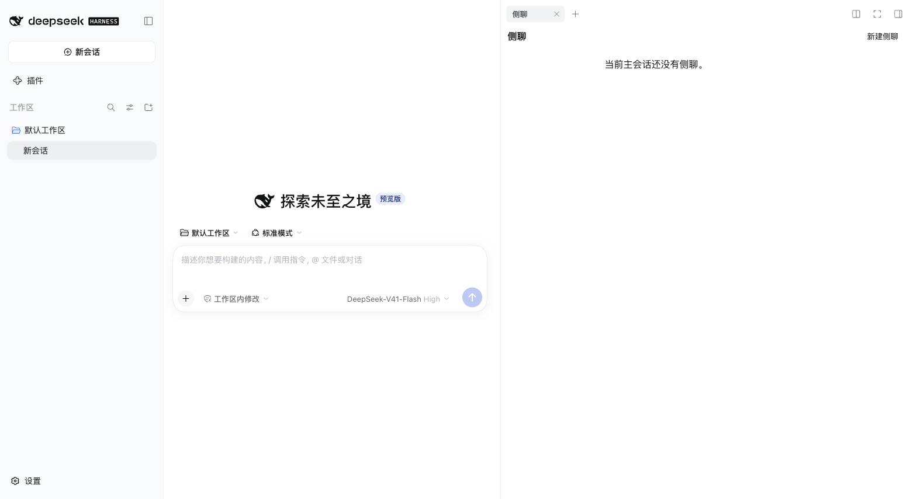

# Phase 0 Evidence

## Scope

Phase 0 is limited to the empty native right-sidebar tab and a finite unary Typert `ping`. Session creation, prompts, uploads, SSE, and WebSocket behavior remain out of scope. No `dsh-sidenote` code was installed or copied.

## Local code/package checks

| Check | Result |
|---|---|
| Root workspace tests: `node --test tests/*.test.mjs` | PASS — 1/1 |
| Package tests: `pnpm --dir packages/dsh-sidechat test` | PASS — 15/15 |
| Package build: `pnpm --dir packages/dsh-sidechat run build` | PASS — Host/Client typecheck and build; Client emitted as a DSH lazy-CJS registration bundle |
| Fresh `dsh-sidechat-0.1.0.tgz` | PASS — pack contains `lib/client.js`; bundle registration/materialization tests pass; isolated DSH Web cold boot details below |

The Client typecheck imports the exact DSH 0.1.7-rc.2 Remote, sidebar, layout, and renderer declaration modules. It caught and prevented use of the nonexistent `ctx.on('dispose')` event; current source uses `ctx.effect` for fiber-owned cleanup and rolls back the Remote mount if tab registration throws.

## Runtime profile investigation

- The target app's `lib/main.js` was extracted read-only from `app.asar`; the extracted bytes matched the archive SHA-256 integrity record. It confirms `DSH_HOME` is configurable and the Desktop profile/lock live under `$DSH_HOME/profiles/desktop`.
- The app-bundled CLI was verified against the target (`0.1.7-rc.2`) and successfully used with `plugin --profile web add` and `--profile web --host 127.0.0.1 --port 0 --no-open`; the `dsh` command itself is not on the shell `PATH`.
- An isolated scratch Web profile installed the candidate tarball plus a read-only link to `dsh-better-sidebar@0.19.1`. Cold start loaded both `dsh-sidechat` and `dsh-better-sidebar` in `window.__DSH_BOOT__.entries`; the page had no failed-plugin banner. No active profile was changed.
- The first Web artifact was ESM and failed in the host's classic-script loader (`Unexpected token 'export'`). It now emits the RC2 lazy-CJS factory registration and bundles `zod`; the corrected package loaded on cold start.
- **`__DSH_BOOT__` co-loading verified (second isolated run, port 57577):** `dsh-sidechat` entry present with `inject: ["@deepseek-ai/dsh-api-remotes", "@deepseek-ai/dsh-client-ui-sidebar-right"]`; `dsh-better-sidebar` entry present with its own independent inject list; `@deepseek-ai/dsh-typert-registry` entry present with `immediately: true`. Total boot entries: 66. No entry conflict, no failed-plugin banner in startup log. Both plugins share the same preload chunk (`rev=d48819079ca2`) without error.
- No session was created. The session-scoped empty tab was therefore not visually opened in an authenticated browser view; the authenticated unary ping was not exercised (all `/api/*` routes return 401 in the unauthenticated scratch profile, which is expected).
- The isolated Desktop launch attempt with `HOME`, `DSH_HOME`, and XDG paths under `/tmp` exited without creating a second window/profile; directly passing Electron `--user-data-dir` was rejected as `bad option`. Desktop profile install via CLI also returns `error: profile "desktop" is managed exclusively by the Electron application`. Desktop smoke test must go through the in-app plugin UI with an isolated Electron `userData` path; no active profile was changed.

## Gate verdict

- Phase 0 code/package: **PASS**.
- Isolated Web cold-start and boot-graph co-loading (both plugins in `__DSH_BOOT__` entries, Typert registry loaded, no error): **PASS**.
- Authenticated tab visibility and unary ping via real session: **NOT VERIFIED** — blocked by scratch profile having no login credentials; requires a real authenticated session (Desktop or logged-in Web).
- Desktop cold-start/coexistence in an isolated profile: **NOT RUN** — blocked by Electron single-instance guard and CLI install restriction; requires in-app plugin UI install path.
- Overall Phase 0 exit gate: **OPEN / NOT PASSED**. Boot-graph co-loading is confirmed only for the older isolated runtime; authenticated tab/ping and current Desktop coexistence remain unverified. Do not infer current-runtime support from this result.

## Current GUI reassessment — 2026-09-30

This section records a newer environment than the historical `0.1.7-rc.2` probe above; it does not rewrite that probe's outcome.

- The listener at `127.0.0.1:19387` is the installed `/Applications/DeepSeek Harness.app` **`0.2.0-rc.2`** process. Its current working directory and opened profile files identify `~/.dsh/profiles/desktop`, **not** `~/.dsh/profiles/web`, as the profile backing this Web GUI.
- The active Desktop profile's `package.json` has no `dsh-sidechat` dependency or `dsh.profile.bundles` entry; its patch has no such entry and `node_modules/dsh-sidechat` does not exist. Thus the Host loader cannot activate the package and the Client cannot reach the boot graph. The old `dsh-better-sidebar` configuration still has `tabsEnabled.sidechat: true`, which is a separate tab, not this plugin.
- A fresh build of the current source passed **231/231** package tests and emitted Host/Client bundles. The pre-existing `packages/dsh-sidechat/dsh-sidechat-0.1.0.tgz` is an older **33,447-byte** Phase 0 package, not that build: it contains an old empty tab and different Client manifest. A fresh **88,043-byte** artifact was created in a temporary `packages/dsh-sidechat/.scratch-runtime/artifacts/` directory for this diagnostic and removed with that disposable directory afterward. Do not distribute the two identical-name/version tarballs interchangeably.
- Using the installed app's own `0.2.0-rc.2` CLI with a repository-local disposable `DSH_HOME`, installation of the **fresh** artifact was **rejected and rolled back**. Its three strict Host peer dependencies require `0.1.7-rc.2`, while the current Host is `0.2.0-rc.2`. The version exemption suggested by the installer was **not** granted; the active profile was not changed.
- Official `0.2.0-rc.2` bundled code still exposes the Session Controller `fork`/`prompt`/`inspect`/`modelCatalog`/`projections`/`selectModel` methods and the permission preset service's `catalog`/`apply` methods at a preliminary source-inspection level. This is **not** a full compatibility audit or runtime validation. Client code awaits Remote `ping` before registering its sidebar tab, so a future ping failure would be another possible gate; it has **not** been observed in the currently uninstalled GUI.

**Pre-migration verdict:** The visible absence is explained by non-installation in the actual active profile. The then-current `0.1.0` artifact was separately blocked by the Host's explicit version-compatibility check. Never bypass that guard as a substitute for migration.

## DSH 0.2.0-rc.2 compatibility build — 2026-09-30

- Package `0.1.1` declares `engines.dsh` and all `@deepseek-ai/dsh-*` peer/dev dependencies at `0.2.0-rc.2`; the matching public APIs typechecked and Typert Host/Client artifacts were regenerated. The version-constraint regression test failed against `0.1.0` before the update and passed afterward.
- The fresh `packages/dsh-sidechat/artifacts/dsh-sidechat-0.1.1.tgz` installed **without an exemption** into a disposable Web profile using the installed app's own `0.2.0-rc.2` CLI. On a cold start at an isolated loopback port, authenticated HTML boot contained `dsh-sidechat`, its Client bundle returned HTTP 200 with the lazy loader and native-tab ID, and an authenticated unary `POST /api/sideChat/ping` returned `{ ok: true, value: { ok: true } }`. Authentication used only the disposable host's own one-time login URL; no active-profile credentials were copied.
- This establishes installation, Host activation, bundle delivery and Remote ping on the new Host, but **does not** establish Client activation or visible tabs. Later real-browser testing found that this `0.1.1` build still lacked Cordis service injection. The current `19387` GUI still uses the untouched active Desktop profile.

## Isolated Web UI probe — 2026-09-30

- In the real Web browser, package `0.1.1` was installed and shown as running by the plugin manager, and its Client bundle loaded, but no sidebar guide appeared. Runtime instrumentation established that its `apply(ctx)` did run; `ctx.remote` failed with `cannot get property "remote" without inject`. This is a separate Cordis plugin-service declaration from the `dsh.client.inject` package-graph dependencies. A focused regression failed before the fix and passed after adding Client `inject: ['remote', 'sidebarRightTabs', 'slots']`.
- Package `0.1.2` progressed through the Remote mount, but `ctx.remote.sideChat` then failed with `cannot get property "remote.sideChat" without inject`. Declaring this dynamic namespace as a static required service would make startup depend on a service that this plugin mounts itself, so `0.1.3` instead uses a child `ctx.inject(['remote.sideChat'], …)` after `$mount`. A second focused regression failed before the fix and passed after it.
- The `0.1.3` tarball installed into the same disposable Web profile without a version exemption and cold-started on a separate loopback port. After normal one-time-URL authentication and selecting an existing empty scratch parent Session, the real browser rendered the native **“新建侧聊”** guide card. Clicking it opened a **“侧聊”** tab and the **“当前主会话还没有侧聊。”** empty-history panel. Browser resource evidence showed authenticated `/api/sideChat/ping` and `/api/sideChat/list` both returned HTTP 200. No prompt or child side-chat Session was created.
- Thus Web native entry/rendering and unary Remote round trips are **PASS** for `0.1.3` in isolation. Desktop cold start and coexistence with `dsh-better-sidebar` remain **NOT VERIFIED**; the user's active `19387` Desktop profile was not modified. The historical `0.1.7` Phase 0 gate above is not retroactively rewritten by this separate current-version Web probe.

